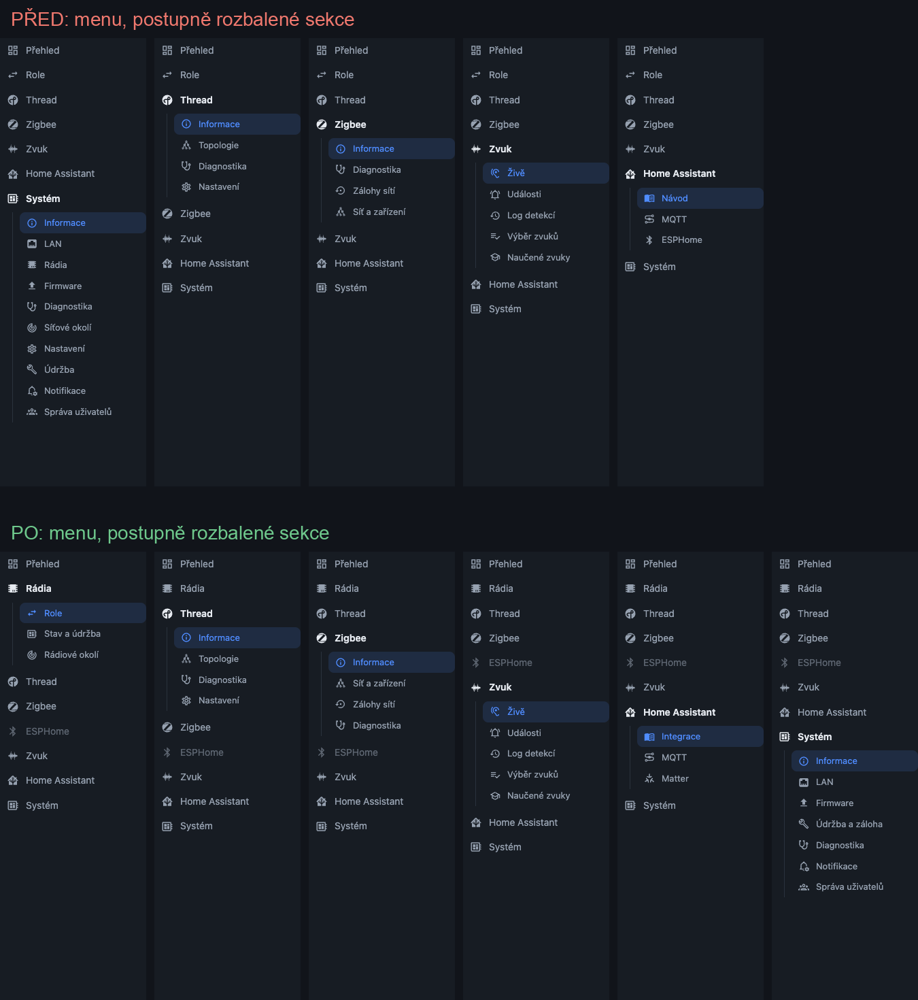
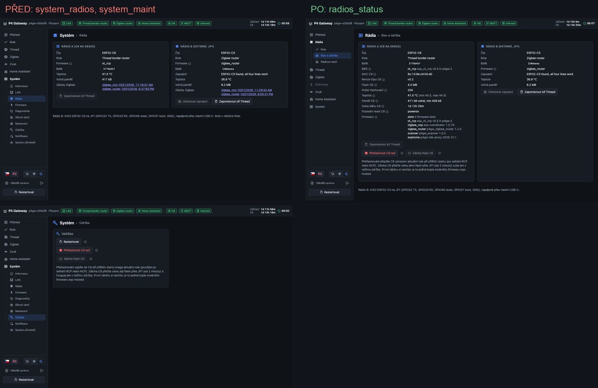
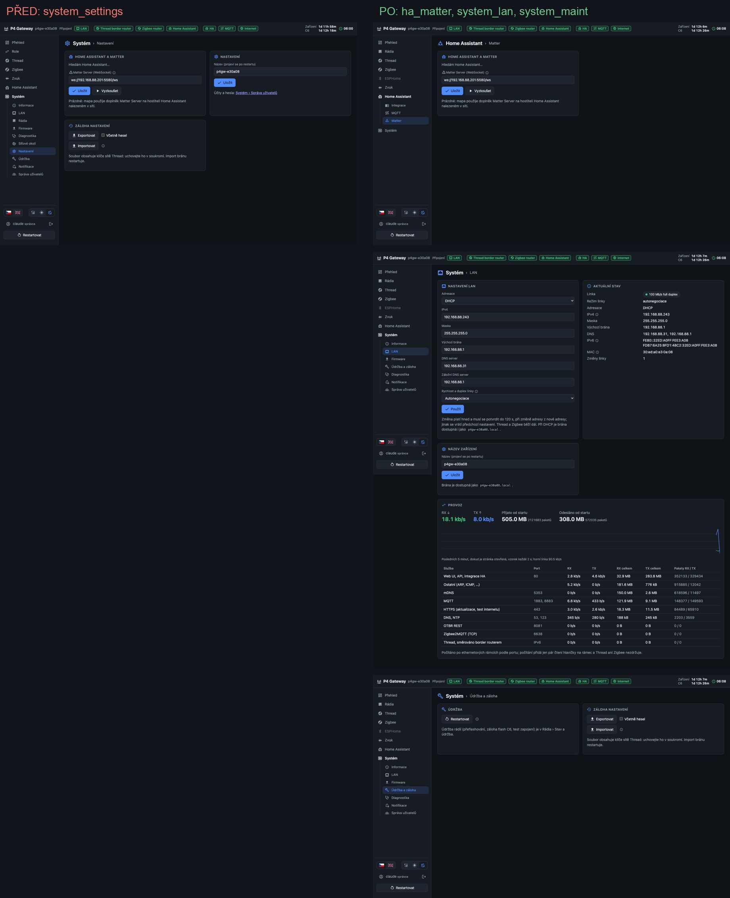

# Přepracování menu webového rozhraní

Menu se rozrůstalo s každou funkcí (druhé rádio, ESPHome jako role rádia, Matter, aktualizace) a
nové položky přibývaly tam, kde zrovna bylo místo, hlavně do sekce Systém. Výsledkem byly stejné
věci na více místech a nastavení jedné věci rozházené po několika sekcích. Tato složka obsahuje
analýzu, nové uspořádání, důvody změn a snímky před a po.

Obsah složky:

| Cesta | Co to je |
|---|---|
| `before/`, `after/` | celé stránky před a po (česky, tmavý motiv, živá data brány) |
| `compare/` | srovnání vedle sebe: `menu.png` (celé menu) a dvojice stránek |
| `inventory_before.json`, `inventory_after.json` | strojový soupis: každá stránka, její karty, tlačítka a odkazy |
| `tools/` | skripty, kterými vznikly soupisy a snímky (viz [Jak snímky obnovit](#jak-snímky-obnovit)) |

## 1. Analýza

### Zdrojově

- Menu je pole `NAV` ve [firmware/gateway/web/index.html](../firmware/gateway/web/index.html), každá stránka je
  funkce `views['sekce/stránka']`; URL je hash (`#system/radios`).
- Oprávnění jsou po stránkách: klíč stránky (`thread/settings`, `system/maint`…) je v `gw_auth.c`
  (`AUTH_MAP`) přiřazený každému API a role má pro každý klíč úroveň skryto / číst / upravovat.
- Sekce Thread a Zigbee se v menu zapínají podle toho, které rádio provozuje danou síť (`isThread()`,
  `isZigbee()`, stránky s `role: true`).

### Vizuálně a obsahem (stav před, 35 stránek)

Soupis všech stránek a karet je v `inventory_before.json`. Nálezy:

1. **Systém měl 12 položek** (Informace, LAN, Rádia, Firmware se 3 podstránkami, Diagnostika,
   Síťové okolí, Nastavení, Údržba, Notifikace, Správa uživatelů s 5 podstránkami) a míchal tři
   různé věci: nastavení zařízení, provoz a údržbu a diagnostiku.
2. **Rádia byla na čtyřech místech**: role v horní položce *Role*, stav a test zapojení v *Systém ›
   Rádia*, podrobnosti C6 v *Systém › Informace* (jen rádio A), přeflashování a záloha C6 v *Systém ›
   Údržba*. Kdo řešil jedno rádio, musel projít tři sekce.
3. **Zálohy Zigbee dvakrát**: *Zigbee › Zálohy sítí* a znovu jako odkazy v kartách *Systém › Rádia*.
   Tabulka v Zigbee navíc neuváděla, ke kterému rádiu záloha patří: po přidání rádia B byly dva řádky
   `zigbee_ncp` k nerozeznání a **tlačítko Stáhnout vždy stáhlo zálohu rádia A** (chyba, opraveno).
   Stránka záloh byla navíc zavřená, když žádné rádio neprovozovalo Zigbee, takže se k zálohám
   nedalo dostat právě ve chvíli, kdy jsou potřeba. Proto vznikly duplicitní odkazy v *Rádia*.
4. **Systém › Nastavení byl šuplík na zbytky**: Matter Server (patří k Home Assistant a mapě
   Thread), název zařízení (patří k síti) a záloha nastavení (patří k údržbě), plus odkaz na správu
   uživatelů, která je o tři řádky níž v menu.
5. **ESPHome pod Home Assistant**: Wi-Fi rádia ESPHome je nastavení sítě, kterou rádio provozuje,
   stejně jako dataset Thread. Thread a Zigbee mají vlastní sekci, ESPHome ne. Text role navíc
   odkazoval na *Home Assistant › ESPHome*.
6. **Síťové okolí v Systému**: je to sken rádiového pásma 2,4 GHz pomocí rádia (firmware skeneru
   v rádiu), pro volbu kanálu Thread, Zigbee a Wi-Fi. S LAN ani se systémem nesouvisí.
7. **Firmware › Nastavení** byla celá stránka pro jedno pole (URL manifestu), oddělená od online
   aktualizace, které se týká. Kvůli chybějící URL vedl odkaz z jedné podstránky na druhou.
8. **Nekonzistentní pořadí**: Thread měl Diagnostiku na konci, Zigbee uprostřed (Informace,
   Diagnostika, Zálohy, Síť).
9. **Odkazy v textu na neexistující cesty** po změnách: „Systém › Údržba pro rádio A“, „změnit v
   Systém › Nastavení“ (mapa Thread), „Role v záložce Role“.

### Postupy obsluhy (před)

| Postup | Kroky před |
|---|---|
| Uvedení do provozu | Systém › Údržba (záloha C6) → Systém › Správa uživatelů → Role → Thread › Nastavení / Zigbee → Home Assistant › Návod |
| Přidat rádio B | Systém › Rádia (test zapojení) → Role (role B) → Systém › Rádia (stav) |
| ESPHome proxy | Home Assistant › ESPHome (Wi-Fi) → Role → Home Assistant › ESPHome (stav) |
| Zjistit, proč rádio nejde | Přehled → Systém › Rádia → Systém › Informace (C6) → Systém › Údržba (přeflashovat) |
| Výběr kanálu | Systém › Síťové okolí → Thread › Nastavení |
| Matter názvy v mapě Thread | Thread › Topologie → odkaz Systém › Nastavení |
| Přenos na novou desku | Systém › Nastavení (záloha nastavení) + Zigbee › Zálohy sítí |
| Aktualizace z vlastního serveru | Systém › Firmware › Nastavení → Systém › Firmware › Online aktualizace |

## 2. Nové uspořádání

Zásady:

- **Sekce podle toho, co obsluha řeší**, ne podle toho, kde to je v kódu: rádia, jednotlivé sítě
  (Thread, Zigbee, ESPHome), zvuk, napojení na Home Assistant, systém brány.
- **Jedna věc na jednom místě.** Duplicity jsou odstraněné.
- **Pořadí sekcí odpovídá nastavování**: nejdřív rádia a jejich role, pak sítě, které rádia
  provozují, zvuk, napojení na Home Assistant a nakonec systém.
- **Stejná stavba sekcí sítí**: Informace → obsah sítě → nastavení nebo zálohy → Diagnostika na konci.
- **Sekce sítě zešedne, když síť neprovozuje žádné rádio** (Thread, Zigbee, nově i ESPHome).
  Stránky, které bez sítě fungují (Zigbee › Síť a zařízení, Zigbee › Zálohy sítí, ESPHome), zůstanou
  otevřené.

```
PŘED                                   PO
Přehled                                Přehled
Role                                   Rádia
Thread                                   Role                    (dřív Role)
  Informace, Topologie,                  Stav a údržba           (dřív Systém › Rádia + C6 ze Systém ›
  Diagnostika, Nastavení                                          Informace + C6 ze Systém › Údržba)
Zigbee                                   Rádiové okolí           (dřív Systém › Síťové okolí)
  Informace, Diagnostika,              Thread
  Zálohy sítí, Síť a zařízení            Informace, Topologie, Diagnostika, Nastavení
Zvuk                                   Zigbee
  Živě, Události, Log detekcí,           Informace, Síť a zařízení, Zálohy sítí, Diagnostika
  Výběr zvuků, Naučené zvuky           ESPHome                   (dřív Home Assistant › ESPHome)
Home Assistant                         Zvuk
  Návod, MQTT, ESPHome                   Živě, Události, Log detekcí, Výběr zvuků, Naučené zvuky
Systém                                 Home Assistant
  Informace, LAN, Rádia,                 Integrace (dřív Návod), MQTT,
  Firmware                               Matter                  (dřív karta v Systém › Nastavení)
    Online, Ruční, Nastavení           Systém
  Diagnostika, Síťové okolí,             Informace (bez C6), LAN (+ název zařízení),
  Nastavení, Údržba, Notifikace,         Firmware
  Správa uživatelů (5 podstránek)          Online aktualizace (+ nastavení aktualizací), Ruční
                                         Údržba a záloha (restart + záloha nastavení),
                                         Diagnostika, Notifikace, Správa uživatelů (5 podstránek)
```

Horní úroveň má 8 položek místo 7 (přibylo ESPHome, Role se stala sekcí Rádia), Systém má 7
položek místo 12. Celkem je 34 stránek místo 35 (zrušené Systém › Nastavení a Firmware › Nastavení,
nové Home Assistant › Matter).



### Změny a důvody

| Změna | Proč |
|---|---|
| **Nová sekce Rádia** (Role, Stav a údržba, Rádiové okolí) | Vše o fyzických rádiích na jednom místě: co dělají, v jakém jsou stavu, jak je opravit a jaké je rádiové okolí. Řeší nález 2 a 6. |
| **Rádia › Stav a údržba**: karta rádia A má úplné podrobnosti C6 a tlačítka *Přeflashovat C6 teď* a *Záloha flash C6* | Údržba rádia patří k rádiu. Systém › Informace a Systém › Údržba už o C6 nic nemají. |
| **Zálohy Zigbee jen v Zigbee › Zálohy sítí**, se sloupcem Rádio; stránka je otevřená v každé roli | Řeší nález 3: jedna tabulka, stažení správné zálohy (včetně rádia B), dostupná i bez běžící sítě Zigbee. Odkazy v kartách rádií odpadly. |
| **ESPHome jako samostatná sekce** | ESPHome je síť provozovaná rádiem, stejně jako Thread a Zigbee, a chová se stejně: zešedne, když ho žádné rádio neprovozuje, ale Wi-Fi jde nastavit předem. Řeší nález 5. |
| **Systém › Nastavení zrušeno**: Matter → Home Assistant › Matter, název zařízení → Systém › LAN, záloha nastavení → Systém › Údržba a záloha | Každá karta je u věci, které se týká (nález 4). Odkaz na správu uživatelů odpadl, protože je přímo v menu. |
| **Home Assistant › Návod → Integrace** | Stránka je postup integrace (HACS, OTBR, Zigbee2MQTT); „Integrace“ odpovídá tomu, co tam uživatel hledá. |
| **Firmware › Nastavení zrušeno**, karta *Nastavení aktualizací* je na stránce Online aktualizace | URL manifestu a stav online aktualizace jsou jedna věc (nález 7). Odkaz mezi podstránkami nahradila věta „nastavte ji v Nastavení aktualizací níže“. |
| **Systém › Údržba → Údržba a záloha** | Restart a záloha nastavení (export a import) jsou provoz brány. Krátká věta odkazuje údržbu rádií do Rádia › Stav a údržba, protože ji tam dřív hledal každý. |
| **Zigbee v pořadí Informace, Síť a zařízení, Zálohy sítí, Diagnostika** | Stejné pořadí jako Thread, diagnostika vždy na konci (nález 8). |
| **Zvuk a Správa uživatelů beze změny** | Byly už logicky uspořádané podle postupu (živě → události → log → výběr → učení; uživatelé → role → tokeny → žádosti → zabezpečení). |

### Postupy obsluhy (po)

| Postup | Kroky po |
|---|---|
| Uvedení do provozu | Rádia › Stav a údržba (záloha C6) → Systém › Správa uživatelů → Rádia › Role → Thread › Nastavení / Zigbee / ESPHome → Home Assistant › Integrace |
| Přidat rádio B | Rádia › Stav a údržba (test zapojení) → Rádia › Role |
| ESPHome proxy | ESPHome (Wi-Fi) → Rádia › Role → ESPHome (stav) |
| Zjistit, proč rádio nejde | Přehled → Rádia › Stav a údržba (podrobnosti i přeflashování na jedné kartě) |
| Výběr kanálu | Rádia › Rádiové okolí → Thread › Nastavení |
| Matter názvy v mapě Thread | Thread › Topologie → odkaz Home Assistant › Matter |
| Přenos na novou desku | Systém › Údržba a záloha + Zigbee › Zálohy sítí |
| Aktualizace z vlastního serveru | Systém › Firmware › Online aktualizace (vše na jedné stránce) |

### Prolinky (jen nutné)

Odkazy zůstaly jen tam, kde věc patří jinam a uživatel ji z dané stránky potřebuje:

| Odkud | Kam | Proč zůstal |
|---|---|---|
| Přehled, karta Rádio B | Rádia › Stav a údržba | Přehled ukazuje jen souhrn, podrobnosti jsou jinde (byl i předtím, cíl upraven). |
| Thread › Topologie, stav Matter Serveru | Home Assistant › Matter | Mapa potřebuje Matter Server pro názvy zařízení. Jeho adresa je ale nastavení napojení na HA, ne Threadu. |
| Upozornění „žádný uživatelský účet“ | Systém › Správa uživatelů | Bezpečnostní upozornění na každé stránce (beze změny). |

Zrušené odkazy: „Účty a hesla: Systém › Správa uživatelů“ (byl hned vedle položky menu), zálohy
Zigbee v kartách rádií (duplicita), odkaz z Online aktualizace na Firmware › Nastavení (karta je
teď na téže stránce).

## 3. Oprávnění a kompatibilita

- **Backend se nemění.** Klíče oprávnění v `gw_auth.c` (a uložené úrovně rolí a uživatelů v NVS)
  zůstávají stejné, nemigruje se nic. Stránka s novou cestou se na starý klíč mapuje tabulkou
  `PERM` v `index.html` (`radios/roles` → `role`, `radios/status` → `system/maint`, `radios/scan` →
  `system/netscan`, `esphome` → `ha/esphome`, `ha/matter` → `system/settings`).
- **Karta z jiné oblasti oprávnění** na stránce (název zařízení na LAN, záloha nastavení v Údržbě)
  má `data-perm`: bez práva se skryje, s právem jen číst má vypnutá tlačítka. Ověřeno uživatelem
  bez práva `system/settings`: karta Název zařízení a Záloha nastavení zmizí, Home Assistant ›
  Matter není v menu.
- **Editor rolí** (Systém › Správa uživatelů › Role a oprávnění) pojmenuje každou oblast podle
  stránek, které ji používají, např. „Rádia › Stav a údržba, Systém › Údržba a záloha“ nebo „Home
  Assistant › Matter, název zařízení, záloha nastavení“.
- **Staré odkazy fungují**: `#role`, `#system/radios`, `#system/netscan`, `#system/settings`,
  `#ha/esphome` a `#system/firmware/settings` přesměrují na nové stránky (záložky v prohlížeči,
  odkazy v dokumentaci a v Telegramu).
- Firmware: poznámka role ESPHome bez Wi-Fi teď odkazuje na stránku ESPHome
  (`role_esphome.c`).

## 4. Ověření

| Co | Výsledek |
|---|---|
| Všech 34 stránek se vykreslí, bez chyb skriptu (soupis `inventory_after.json`) | OK |
| 6 starých cest přesměruje na novou stránku | OK |
| Menu při 5 kombinacích rolí (A+B): Thread BR + Zigbee router, Zigbee koordinátor + nic, ESPHome + Thread BR, nic + ESPHome, Thread router + Zigbee koordinátor | Sekce zešednou a odemknou se podle toho, které rádio síť provozuje; stránky s `role: true` se otevřou jen s běžící sítí (`tools/check_menu.mjs`) |
| Omezený uživatel (bez `system/settings` a `ha/esphome`, `system/maint` jen číst) | Karty a stránky skryté podle oprávnění |
| UI testy `tests/ui/ui_test.mjs` (upravené na nové cesty) přes proxy jen pro čtení | 18 z 25 prošlo. Před změnou prošlo 16 testů (UI01 a UI16 dřív padaly kvůli dvěma rádiím). Zbylá selhání jsou stejná jako před změnou (UI06, UI07, UI18, UI25), nebo jsou to zápisy, které proxy odmítá (UI21–UI23). |
| Sestavení firmwaru brány s novým UI | OK |
| Dokumentace (`tools/docs/build_docs.py`) a dotčené snímky v `documentation/` přefocené | OK, žádný chybějící obrázek |

Na bránu nové UI zatím nahrané není. Všechny snímky vznikly z lokálního souboru přes proxy, která
čte živá data brány a zápisy odmítá.

## 5. Srovnání stránek

| Změna | Obrázek |
|---|---|
| Role → Rádia › Role | [compare/radios_roles.jpg](compare/radios_roles.jpg) |
| Systém › Rádia + Údržba → Rádia › Stav a údržba | [compare/radios_status.jpg](compare/radios_status.jpg) |
| Systém › Síťové okolí → Rádia › Rádiové okolí | [compare/radios_scan.jpg](compare/radios_scan.jpg) |
| Home Assistant › ESPHome → ESPHome | [compare/esphome.jpg](compare/esphome.jpg) |
| Systém › Nastavení → HA › Matter, LAN, Údržba a záloha | [compare/settings_split.jpg](compare/settings_split.jpg) |
| Systém › Informace bez C6 | [compare/system_info.jpg](compare/system_info.jpg) |
| Firmware: online aktualizace a její nastavení na jedné stránce | [compare/firmware.jpg](compare/firmware.jpg) |
| Zigbee › Zálohy sítí se sloupcem Rádio | [compare/zigbee_backups.jpg](compare/zigbee_backups.jpg) |
| Role a oprávnění: názvy oblastí | [compare/permissions.jpg](compare/permissions.jpg) |





## Jak snímky obnovit

```sh
# proxy: lokální index.html, API brány s tokenem, jen pro čtení
P4GW_TOKEN=<admin token> python3 menu_redesign/tools/ui_proxy.py <index.html> 192.168.88.243 8089
# soupis, celé stránky, menu, kontrola menu
ROUTES="overview radios/roles …" OUT=menu_redesign/inventory_after.json node <browser.mjs> http://127.0.0.1:8089/ --script menu_redesign/tools/inventory.mjs
ROUTES="overview radios/roles …" OUTDIR=menu_redesign/after node <browser.mjs> http://127.0.0.1:8089/ --script menu_redesign/tools/shoot.mjs
SECTIONS="radios/roles thread/info …" OUTDIR=menu_redesign/compare/menu_after node <browser.mjs> http://127.0.0.1:8089/ --script menu_redesign/tools/menu_shot.mjs
node <browser.mjs> http://127.0.0.1:8089/ --script menu_redesign/tools/check_menu.mjs
python3 menu_redesign/tools/compare.py
```

`<browser.mjs>` je skript skillu browser-automation. Stav „před“ je `index.html` z commitu
0b13d95 (`git show 0b13d95:firmware/gateway/web/index.html`).
